# 🚀 Jenkins CI/CD Pipeline — Lab 2

[](https://www.jenkins.io/)
[](https://www.docker.com/)
[](https://openjdk.org/)
[](https://maven.apache.org/)
[](https://spring.io/)

Pipeline **CI/CD as Code** réalisé avec **Jenkins, Maven, Docker et un Jenkinsfile versionné sur GitHub**.

Ce projet fait suite au Lab 1 et met en œuvre l’approche **Pipeline as Code** pour automatiser la récupération du code source, la compilation de l’application Spring Boot, la construction de l’image Docker et le déploiement du conteneur.

---

## 📄 Rapport complet

Le rapport détaillé du Lab 2 peut être ajouté dans le dossier `rapport-lab2/`.

## 📋 Sommaire

- [1. Présentation du projet](#1-présentation-du-projet)
- [2. Architecture](#2-architecture)
- [3. Prérequis](#3-prérequis)
- [4. Installation de Java 21 et vérification de Jenkins](#4-installation-de-java-21-et-vérification-de-jenkins)
- [5. Préparation du projet](#5-préparation-du-projet)
- [6. Installation des plugins Jenkins](#6-installation-des-plugins-jenkins)
- [7. Configuration des outils globaux](#7-configuration-des-outils-globaux)
- [8. Configuration du Cloud Docker](#8-configuration-du-cloud-docker)
- [9. Création du Pipeline Jenkins](#9-création-du-pipeline-jenkins)
- [10. Création du Jenkinsfile](#10-création-du-jenkinsfile)
- [11. Exécution du Pipeline](#11-exécution-du-pipeline)
- [12. Résultats et compétences acquises](#12-résultats-et-compétences-acquises)
- [13. Structure du dépôt](#13-structure-du-dépôt)
- [14. Auteur et ressources](#14-auteur-et-ressources)

---

## 1. Présentation du projet

### 🎯 Objectif

Mettre en place un pipeline CI/CD automatisé pour une application Spring Boot en utilisant :

- **Jenkins** : automatisation des étapes du pipeline.
- **Jenkinsfile** : définition du pipeline sous forme de code.
- **Java 21** : environnement Java.
- **Maven** : compilation et packaging de l’application.
- **Docker** : construction et exécution du conteneur.
- **Git et GitHub** : gestion et hébergement du code source.

### 🛠️ Technologies utilisées

| Technologie | Version documentée | Rôle |
|---|---|---|
| Ubuntu Server | 26.04 | Système d’exploitation |
| Java JDK | 21 | Environnement Java |
| Maven | 3.9.12 | Compilation et packaging |
| Docker | 29.1.3 | Conteneurisation |
| Jenkins | 2.580.1 | Automatisation CI/CD |
| Spring Boot | 2.1.5 | Framework applicatif |
| Git | — | Gestion du code source |
| GitHub | — | Hébergement du dépôt |

> Remarque : les versions indiquées correspondent à l’environnement documenté du TP. Vérifie les versions réellement installées avant de reproduire les commandes.

## 2. Architecture

Le pipeline est exécuté sur une machine virtuelle Ubuntu Server appelée `master`.

```text
                   DÉVELOPPEUR
                        |
                        v
                    GITHUB
              Code source + Jenkinsfile
                        |
                        v
                  JENKINS MASTER
                    Port 8080
                        |
                        v
                 JENKINSFILE
                        |
                        v
                  BUILD MAVEN
                        |
                        v
                 IMAGE DOCKER
                        |
                        v
                CONTENEUR DOCKER
                  devopsexample
                        |
                        v
                  PORT 2222
                        |
                        v
                APPLICATION WEB
```

### Configuration de la machine virtuelle

| Paramètre | Valeur documentée |
|---|---|
| Hostname | `master` |
| Adresse IP | `192.168.159.15` |
| Système | Ubuntu Server |
| Mémoire | 4 Go |
| Port Jenkins | `8080` |
| Port de l’application | `2222` |

Les valeurs doivent être adaptées si la configuration réelle de la machine virtuelle est différente.

## 3. Prérequis

Avant de commencer, les éléments suivants doivent être disponibles :

- Une machine virtuelle Ubuntu Server.
- Java JDK 21.
- Jenkins installé et opérationnel.
- Maven installé.
- Docker installé et configuré.
- Un compte GitHub.
- Un dépôt Git contenant l’application Spring Boot.
- Les droits nécessaires pour exécuter Docker depuis Jenkins.

### Vérification des outils

```bash
java -version
javac -version
mvn -version
docker --version
git --version
sudo systemctl status jenkins
```

## 4. Installation de Java 21 et vérification de Jenkins

### 🎯 Objectif

Installer Java 21 et vérifier que Jenkins fonctionne correctement.

### 4.1 Installation de Java 21

```bash
sudo apt update
sudo apt install -y fontconfig openjdk-21-jre openjdk-21-jdk
```

### 4.2 Vérification de Java

```bash
java -version
javac -version
ls /usr/lib/jvm/
ls /usr/lib/jvm/java-21-openjdk-amd64/bin/javac
```

Le répertoire Java attendu est :

```text
/usr/lib/jvm/java-21-openjdk-amd64
```

### 4.3 Vérification du service Jenkins

```bash
sudo systemctl status jenkins
```

Le service doit afficher un état similaire à :

```text
Active: active (running)
```

### 4.4 Accès à Jenkins

Depuis le navigateur de la machine hôte, ouvrir :

```text
http://192.168.159.15:8080
```

Adapter l’adresse IP si nécessaire.

### 📸 Captures

**Capture 01 — Installation de Java 21**

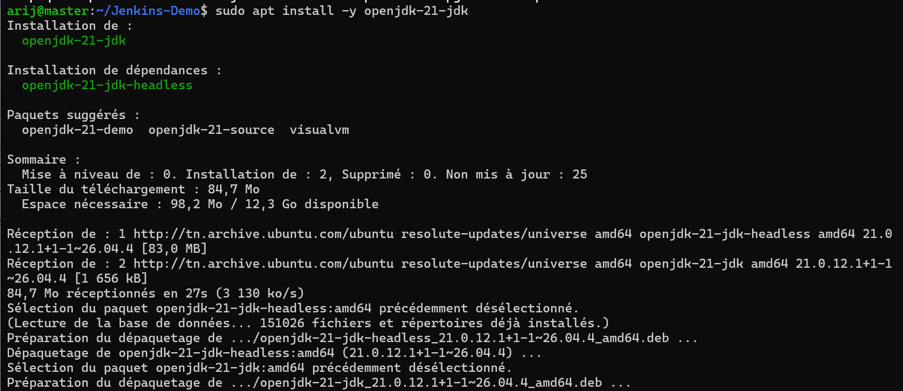

**Capture 02 — Vérification des versions Java**

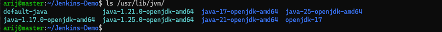

**Capture 03 — Vérification du chemin javac**

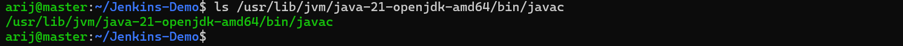

**Capture 04 — Vérification du service Jenkins**

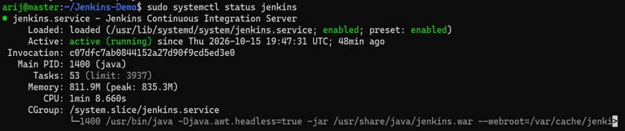

**Capture 05 — Tableau de bord Jenkins**

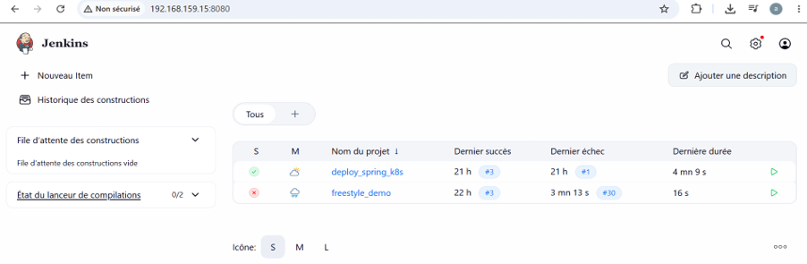

## 5. Préparation du projet

### 🎯 Objectif

Récupérer le projet Spring Boot depuis GitHub et personnaliser la page HTML de l’application.

### 5.1 Clonage du dépôt

```bash
cd ~
git clone https://github.com/arijbelaid/Jenkins-Demo.git
cd Jenkins-Demo
```

Vérifier les fichiers :

```bash
ls -la
```

### 5.2 Vérification du dépôt distant

```bash
git remote -v
```

Le dépôt distant attendu est :

```text
origin  https://github.com/arijbelaid/Jenkins-Demo.git (fetch)
origin  https://github.com/arijbelaid/Jenkins-Demo.git (push)
```

### 5.3 Personnalisation de la page HTML

Ouvrir le fichier :

```bash
nano src/main/resources/static/index.html
```

La page personnalisée présente notamment :

- Le titre « Arij Belaid - Jenkins CI/CD Pipeline ».
- Un fond dégradé violet.
- Des badges représentant Docker, Jenkins, Kubernetes, Maven, Spring Boot et Git.

### 5.4 Publication sur GitHub

```bash
git add src/main/resources/static/index.html
git commit -m "feat: personnalisation de la page HTML"
git push origin main
```

### 📸 Captures

**Capture 06 — Dépôt GitHub**

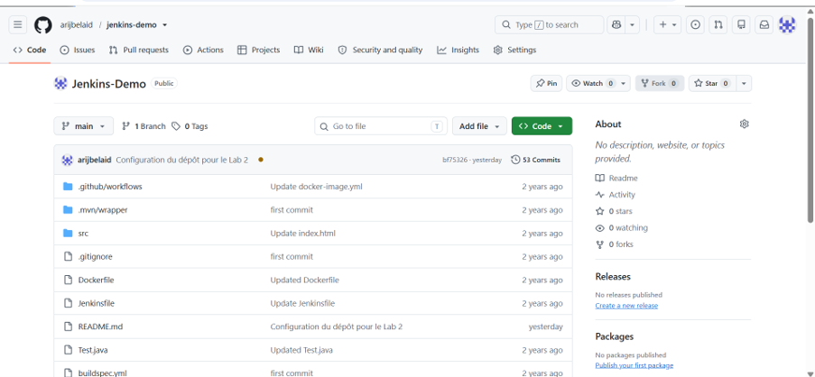

**Capture 07 — Structure du projet**

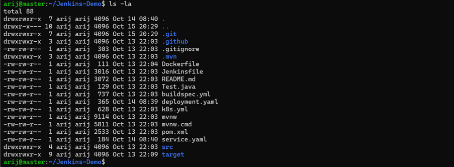

**Capture 08 — Vérification du remote Git**

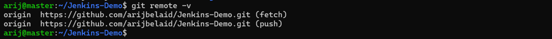

**Capture 09 — Personnalisation du fichier index.html**

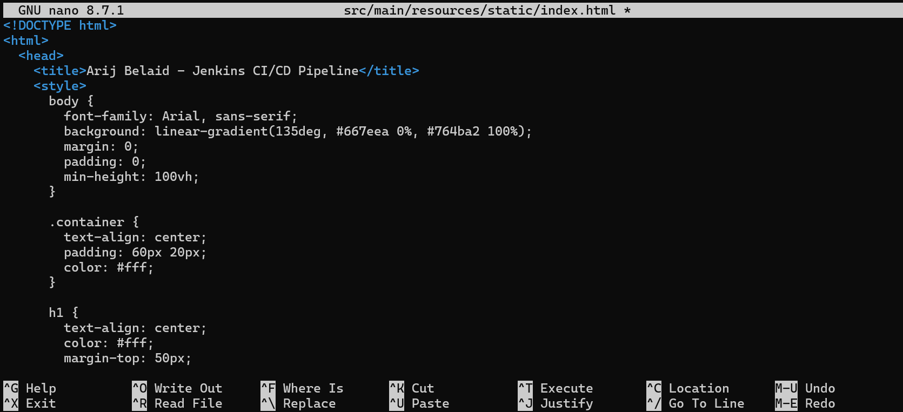

**Capture 10 — Publication sur GitHub**

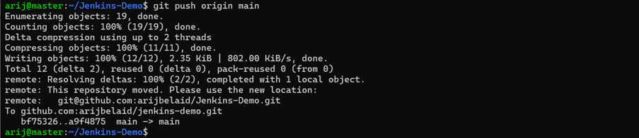

## 6. Installation des plugins Jenkins

### 🎯 Objectif

Installer les plugins nécessaires à la configuration et à l’exécution du pipeline.

### 6.1 Plugins utilisés

| Plugin | Rôle |
|---|---|
| Kubernetes CLI | Interaction avec Kubernetes |
| Maven Integration | Intégration Maven dans Jenkins |
| Docker | Intégration Docker |
| Docker Pipeline | Utilisation de Docker dans les pipelines |
| Docker Build Step | Étapes de construction Docker |

Les versions des plugins peuvent évoluer. Installer des versions compatibles avec celle de Jenkins.

### 6.2 Procédure d’installation

1. Ouvrir Jenkins.
2. Accéder à **Administrer Jenkins → Plugins**.
3. Ouvrir les plugins disponibles.
4. Rechercher les plugins nécessaires.
5. Sélectionner les plugins souhaités.
6. Cliquer sur le bouton d’installation.
7. Attendre la fin de l’installation et redémarrer Jenkins si nécessaire.

### 📸 Captures

**Capture 11 — Menu des plugins**

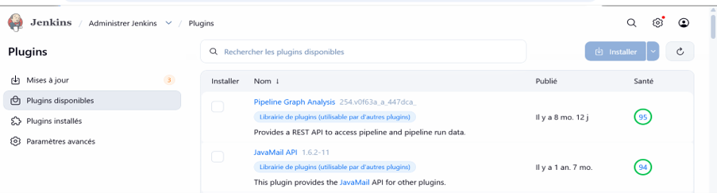

**Capture 12 — Plugin Kubernetes CLI**

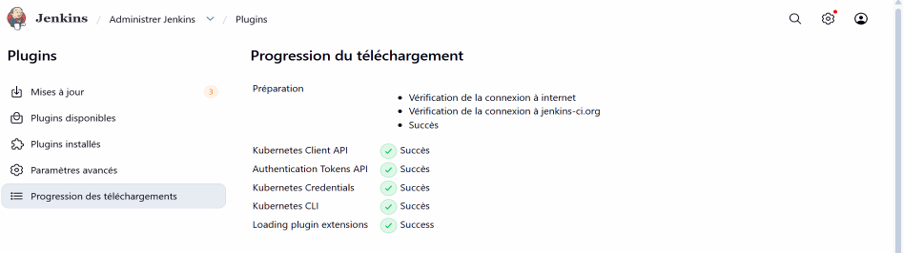

**Capture 13 — Plugin Maven Integration**

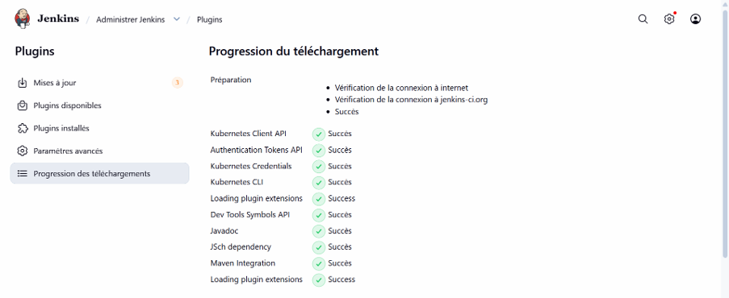

**Capture 14 — Plugins Docker**

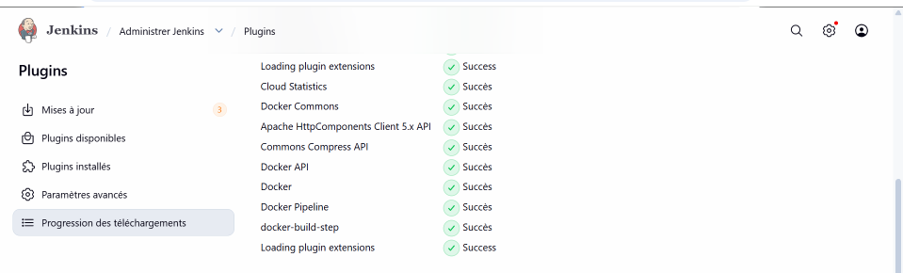

## 7. Configuration des outils globaux

### 🎯 Objectif

Configurer Java, Maven et Docker dans Jenkins afin que le pipeline puisse utiliser ces outils.

Accéder à **Administrer Jenkins → Tools** ou **Global Tool Configuration**, selon la version de Jenkins.

### 7.1 Configuration du JDK

| Champ | Valeur |
|---|---|
| Name | `jdk-21` |
| JAVA_HOME | `/usr/lib/jvm/java-21-openjdk-amd64` |
| Install automatically | Désactivé |

### 7.2 Configuration de Maven

| Champ | Valeur |
|---|---|
| Name | `maven-3.9.12` |
| MAVEN_HOME | `/usr/share/maven` |
| Install automatically | Désactivé |

Vérifier le chemin de Maven :

```bash
which mvn
mvn -version
```

### 7.3 Configuration de Docker

Si le plugin et le type d’installation utilisés le permettent, configurer Docker dans Jenkins avec le nom :

```text
MyDocker
```

Le nom doit correspondre à celui utilisé dans la configuration du pipeline si l’outil est déclaré dans le `Jenkinsfile`.

### 📸 Captures

**Capture 15 — Menu Tools**

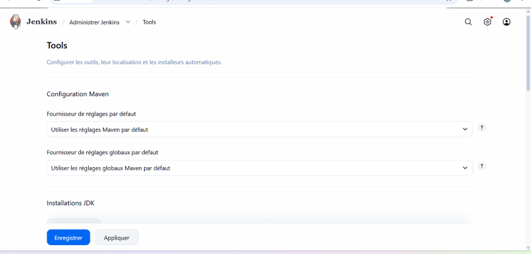

**Capture 16 — Configuration du JDK 21**

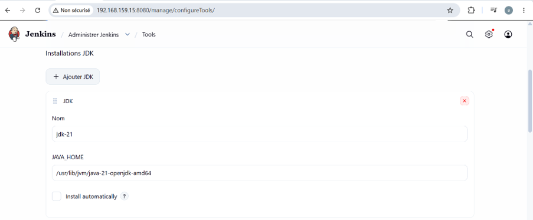

**Capture 17 — Configuration de Maven**

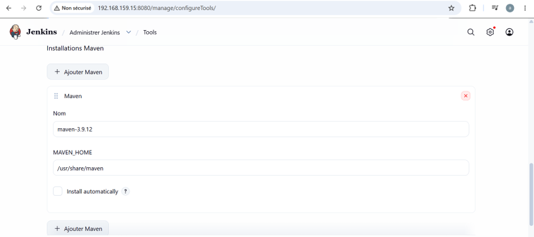

**Capture 18 — Configuration de Docker**

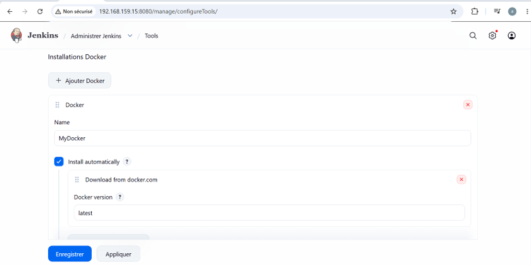

## 8. Configuration du Cloud Docker

### 🎯 Objectif

Configurer la connexion entre Jenkins et le démon Docker local.

### 8.1 Création du Cloud

Dans Jenkins, accéder à la section de configuration des Clouds si le plugin correspondant est installé.

Créer un Cloud nommé :

```text
docker-local
```

### 8.2 Paramètres de connexion

| Champ | Valeur |
|---|---|
| Cloud name | `docker-local` |
| Type | Docker |
| Docker Host URI | `unix:///var/run/docker.sock` |
| Server credentials | Aucun, si non requis |
| Enabled | Activé |

### 8.3 Vérification de Docker

Sur la machine virtuelle :

```bash
sudo systemctl status docker
docker --version
sudo -u jenkins docker ps
```

La commande `docker ps` exécutée par Jenkins doit fonctionner. Une erreur de permission indique que les droits d’accès au socket Docker doivent être corrigés.

> La configuration d’un Cloud Docker Jenkins dépend du plugin utilisé. La connexion au socket local et l’exécution de commandes Docker dans le pipeline sont deux mécanismes distincts.

### 📸 Captures

**Capture 19 — Création du Cloud Docker**

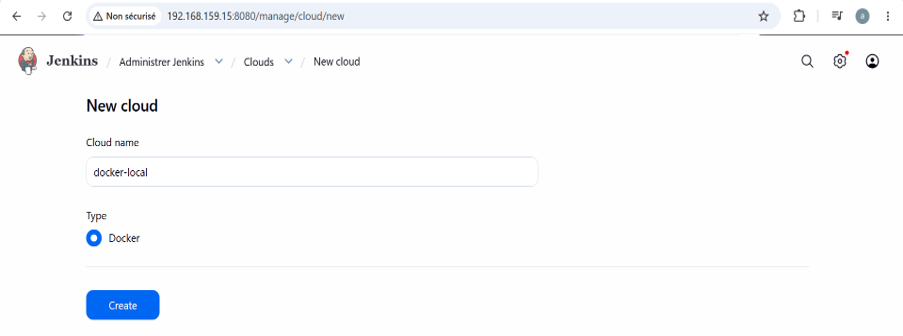

**Capture 20 — Configuration du Cloud Docker**

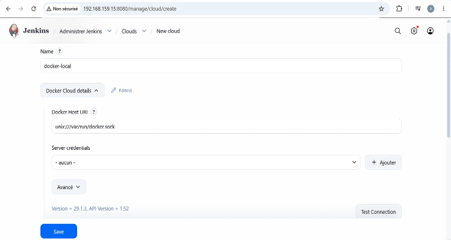

**Capture 21 — Vérification du Cloud**

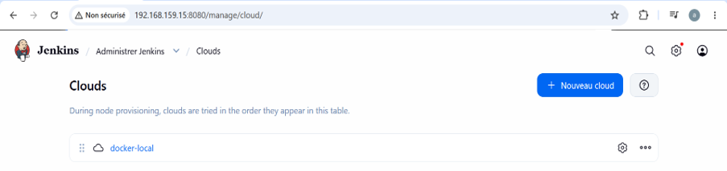

## 9. Création du Pipeline Jenkins

### 🎯 Objectif

Créer un job Pipeline nommé `Jenkins_test` qui récupère le `Jenkinsfile` depuis GitHub.

### 9.1 Création du job

1. Ouvrir le tableau de bord Jenkins.
2. Cliquer sur **Nouvel Item**.
3. Saisir le nom `Jenkins_test`.
4. Choisir le type **Pipeline**.
5. Valider avec **OK**.

### 9.2 Configuration du dépôt Git

| Champ | Valeur |
|---|---|
| Nom du job | `Jenkins_test` |
| Type | Pipeline |
| GitHub project | `https://github.com/arijbelaid/Jenkins-Demo` |
| Definition | Pipeline script from SCM |
| SCM | Git |
| Repository URL | `https://github.com/arijbelaid/Jenkins-Demo.git` |
| Credentials | Aucun pour un dépôt public |
| Branch Specifier | `*/main` |
| Script Path | `Jenkinsfile` |

Enregistrer la configuration.

### 📸 Captures

**Capture 22 — Création du job Pipeline**

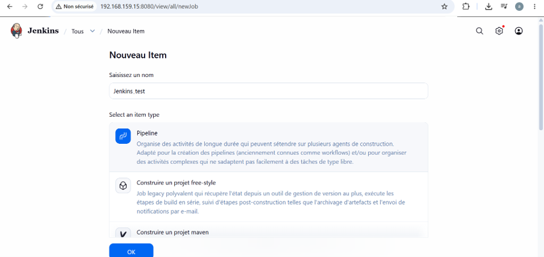

**Capture 23 — Configuration du projet GitHub**

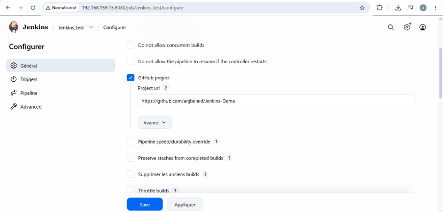

**Capture 24 — Configuration Pipeline from SCM**

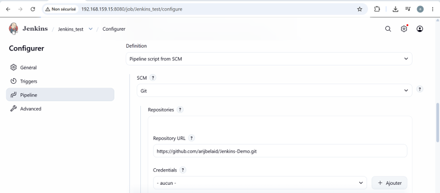

## 10. Création du Jenkinsfile

### 🎯 Objectif

Définir les différentes étapes du pipeline sous forme de code Groovy, puis versionner le fichier dans GitHub.

### 10.1 Étapes du pipeline

Le pipeline déclaratif comprend les étapes suivantes :

1. Récupération du code depuis GitHub.
2. Compilation et packaging avec Maven.
3. Vérification et adaptation du Dockerfile.
4. Construction de l’image Docker.
5. Déploiement du conteneur.
6. Vérification de l’application.

### 10.2 Exemple de Jenkinsfile

```groovy
pipeline {
    agent any

    tools {
        jdk 'jdk-21'
        maven 'maven-3.9.12'
    }

    environment {
        DOCKER_IMAGE = "arijbelaid/jenkins-demo:${env.BUILD_NUMBER}"
    }

    stages {
        stage('Clone Repo') {
            steps {
                echo 'Récupération du dépôt GitHub...'
                checkout scm
                sh 'git log -1 --oneline'
            }
        }

        stage('Build Project') {
            steps {
                echo 'Build Maven...'
                sh 'mvn clean package -DskipTests'
                sh 'ls -la target/'
            }
        }

        stage('Fix Dockerfile') {
            steps {
                echo 'Vérification du Dockerfile...'
                sh '''
                    sed -i 's|openjdk:17-jdk-slim|eclipse-temurin:17-jre|g' Dockerfile
                    sed -i 's|openjdk:17-jdk|eclipse-temurin:17-jre|g' Dockerfile
                    cat Dockerfile
                '''
            }
        }

        stage('Build Docker Image') {
            steps {
                echo "Construction de l'image Docker ${DOCKER_IMAGE}..."
                sh 'docker build -t "$DOCKER_IMAGE" .'
            }
        }

        stage('Deploy Docker Container') {
            steps {
                echo 'Déploiement du conteneur...'
                sh '''
                    docker stop devopsexample || true
                    docker rm devopsexample || true

                    docker run --name devopsexample -d \
                      -p 2222:2222 "$DOCKER_IMAGE"
                '''
            }
        }

        stage('Verify') {
            steps {
                echo 'Vérification du déploiement...'
                sh '''
                    sleep 10
                    docker ps | grep devopsexample
                    curl -fsS http://localhost:2222/ | head -20
                '''
            }
        }
    }

    post {
        success {
            echo 'Pipeline terminé avec succès !'
        }

        failure {
            echo 'Le pipeline a échoué.'
        }
    }
}
```

> **Important :** ce fichier suppose que le projet contient un `Dockerfile` adapté, que l’application écoute réellement sur le port `2222` dans le conteneur et que Docker est accessible depuis l’agent Jenkins. Adapter le port et l’URL de test à la configuration réelle de l’application.

### 10.3 Publication du Jenkinsfile

Dans le répertoire du projet :

```bash
git add Jenkinsfile
git commit -m "feat: Jenkinsfile personnalisé pour le Lab 2"
git push origin main
```

### 📸 Captures

**Capture 25 — Création du Jenkinsfile**

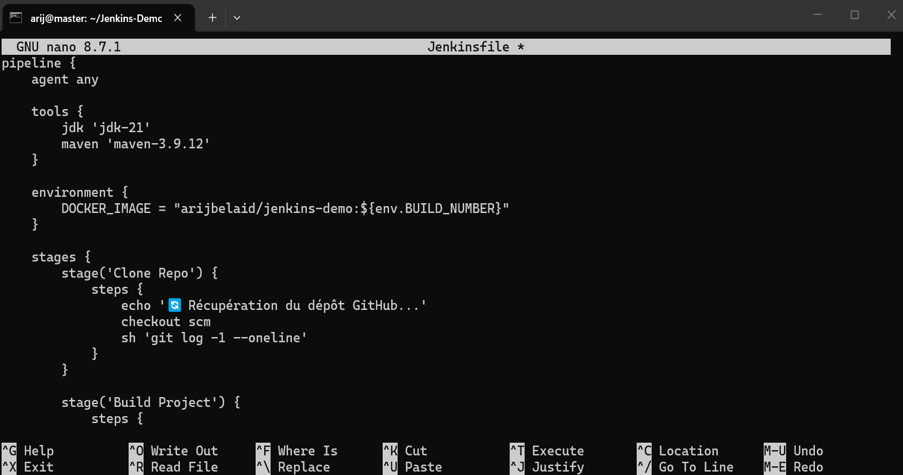

**Capture 26 — Publication du Jenkinsfile**

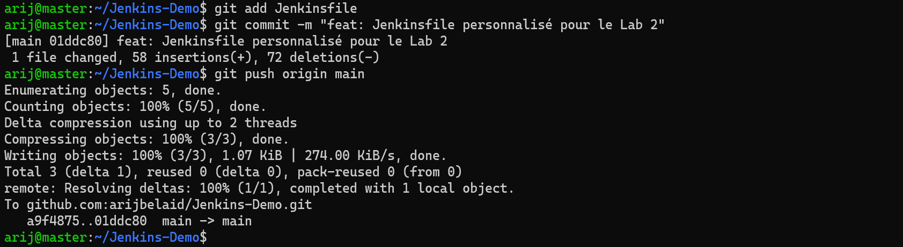

## 11. Exécution du Pipeline

### 🎯 Objectif

Lancer le job `Jenkins_test` et vérifier l’exécution des différentes étapes.

### 11.1 Vérifications préalables

Vérifier que le port `2222` n’est pas déjà utilisé :

```bash
sudo lsof -i :2222
```

Vérifier l’accès Docker de Jenkins :

```bash
sudo -u jenkins docker ps
```

Vérifier le dernier commit du projet :

```bash
cd ~/Jenkins-Demo
git log -1 --oneline
```

### 11.2 Lancement du pipeline

Dans Jenkins :

1. Ouvrir le job `Jenkins_test`.
2. Cliquer sur **Build Now** ou **Lancer un build**.
3. Ouvrir le build lancé.
4. Consulter **Console Output**.
5. Vérifier l’état des différentes étapes.

### 11.3 Résultat attendu

```text
[Pipeline] End of Pipeline
Pipeline terminé avec succès !
Finished: SUCCESS
```

Le numéro du build et les messages exacts peuvent varier selon l’exécution.

### 11.4 Étapes du pipeline

| Étape | Description |
|---|---|
| Clone Repo | Récupération du code depuis GitHub |
| Build Project | Compilation et packaging Maven |
| Fix Dockerfile | Vérification du Dockerfile |
| Build Docker Image | Construction de l’image Docker |
| Deploy Docker Container | Lancement du conteneur |
| Verify | Vérification de l’exécution et de l’accès à l’application |

### 📸 Captures du pipeline

**Capture 27 — Vérifications préalables**

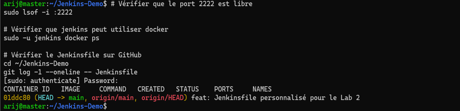

**Capture 28 — Lancement du build**

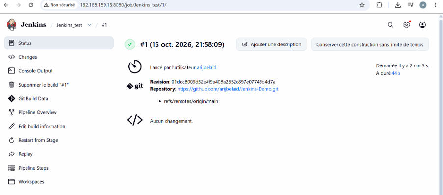

**Capture 29 — Console du pipeline**

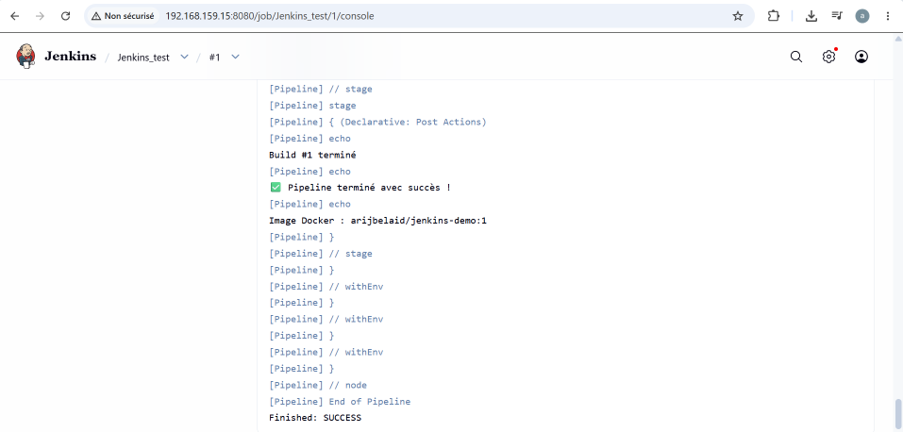

**Capture 30 — Étapes du pipeline**

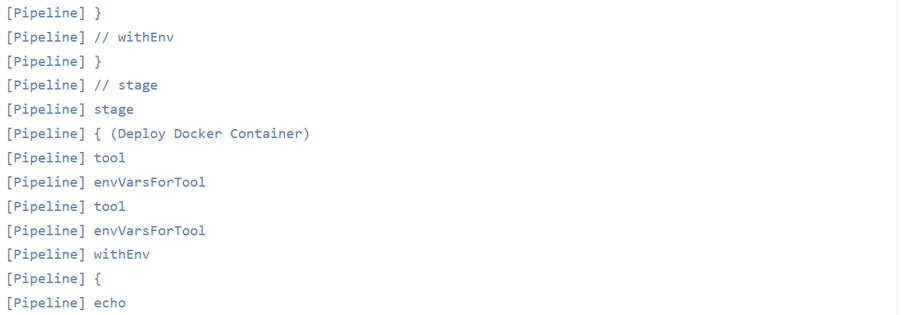

**Capture supplémentaire — Affichage détaillé des étapes**

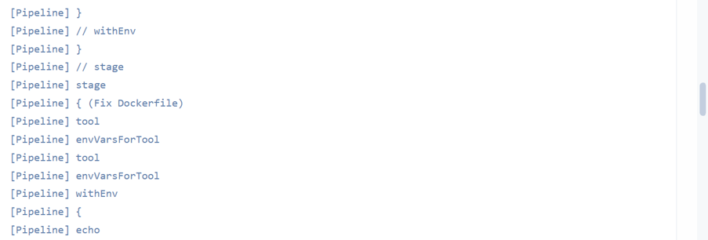

### 11.5 Vérification du conteneur Docker

Sur la machine `master` :

```bash
docker ps
```

Vérifier les images :

```bash
docker images | grep jenkins-demo
```

Tester l’application localement :

```bash
curl -I http://localhost:2222
```

Si l’application ne répond pas sur `/`, tester un endpoint réellement exposé par le projet.

### 📸 Captures complémentaires

**Capture 32 — Images Docker**

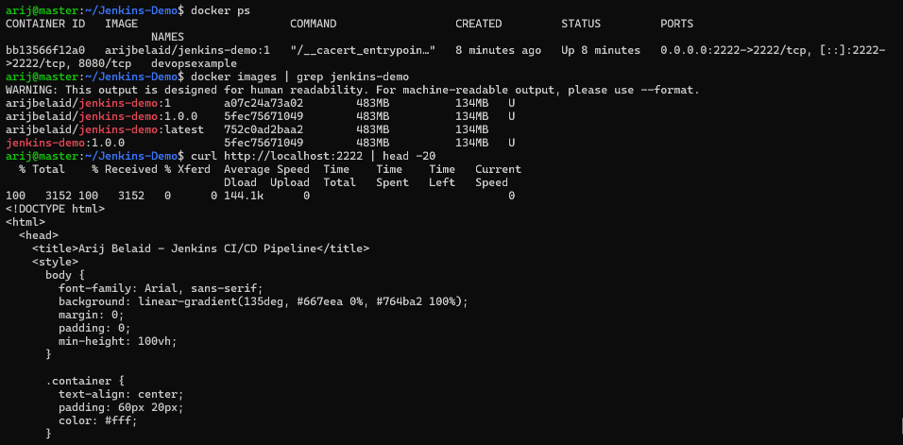

**Capture 33 — Test de l’application avec cURL**

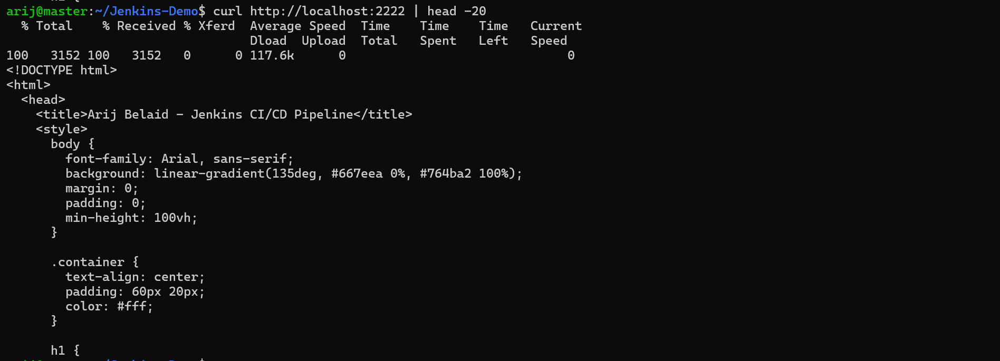

### 11.6 Test depuis Windows

Depuis le navigateur Windows, ouvrir :

```text
http://192.168.159.15:2222
```

Adapter l’adresse IP et le port selon la configuration réelle du conteneur.

La page personnalisée doit afficher le titre :

**Arij Belaid - Jenkins CI/CD Pipeline**

### Capture 34 — Application dans le navigateur Windows

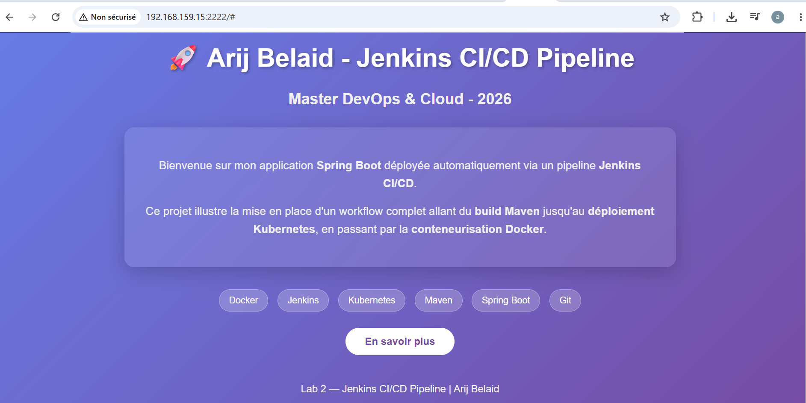

## 12. Résultats et compétences acquises

### 📊 Bilan du Lab 2

| Partie | Description | Résultat attendu |
|---|---|---|
| 1 | Installation de Java 21 et vérification de Jenkins | Réalisé |
| 2 | Préparation du projet et intégration GitHub | Réalisé |
| 3 | Installation des plugins Jenkins | Réalisé |
| 4 | Configuration des outils globaux | Réalisé |
| 5 | Configuration du Cloud Docker | Réalisé |
| 6 | Création du job Pipeline | Réalisé |
| 7 | Écriture et versionnement du Jenkinsfile | Réalisé |
| 8 | Exécution et vérification du pipeline | Réalisé |

### 🎓 Compétences acquises

- Compréhension de l’approche **Pipeline as Code**.
- Écriture d’un pipeline déclaratif avec Groovy.
- Configuration des outils globaux Jenkins.
- Intégration de Git et GitHub.
- Compilation et packaging avec Maven.
- Construction d’images Docker.
- Exécution et vérification de conteneurs.
- Automatisation des étapes d’un pipeline Jenkins.
- Analyse des logs et diagnostic des échecs.
- Compréhension des bases d’un processus CI/CD.

## 13. Structure du dépôt

La structure suivante représente les fichiers et captures du Lab 2.

```text
Jenkins-Demo/
├── Jenkinsfile
├── Dockerfile
├── pom.xml
├── src/
│   └── main/
│       └── resources/
│           └── static/
│               └── index.html
├── rapport-lab2/
│   └── rapport.pdf
├── captures/
│   ├── 01-java21-installation.png
│   ├── 02-java-version-check.png
│   ├── 03-javac-path.png
│   ├── 04-jenkins-status.png
│   ├── 05-jenkins-dashboard.png
│   ├── 06-github-repo.png
│   ├── 07-ls-project.png
│   ├── 08-git-remote.png
│   ├── 09-index-html.png
│   ├── 10-git-push.png
│   ├── 11-plugins-menu.png
│   ├── 12-kubernetes-cli.png
│   ├── 13-maven-integration.png
│   ├── 14-docker-plugins.png
│   ├── 15-tools-menu.png
│   ├── 16-jdk-config.png
│   ├── 17-maven-config.png
│   ├── 18-docker-config.png
│   ├── 19-new-cloud.png
│   ├── 20-docker-cloud-config.png
│   ├── 21-cloud-verify.png
│   ├── 22-new-item.png
│   ├── 23-github-project.png
│   ├── 24-pipeline-scm.png
│   ├── 25-jenkinsfile-nano.png
│   ├── 26-jenkinsfile-push.png
│   ├── 27-preverification.png
│   ├── 28-build-now.png
│   ├── 29-console-success.png
│   ├── 30-console-stages.png
│   ├── 30-console-stages1.png
│   ├── 32-docker-images.png
│   ├── 33-curl-app.png
│   └── 34-app-windows.png
└── README.md
```

> Le fichier `31-docker-ps.png` n’apparaît pas dans la liste des captures fournies ; il n’est donc pas référencé ici. Le fichier `rapport.pdf` doit être ajouté au dossier `rapport-lab2/` si tu souhaites publier le rapport complet.

## 14. Auteur et ressources

### 👩‍💻 Auteur

**Arij Belaid**

Étudiante en Master Professionnel DevOps & Cloud.

### Domaines d’intérêt

- DevOps et DevSecOps
- Cloud Computing
- Automatisation
- Conteneurisation
- Intégration et déploiement continus (CI/CD)
- Kubernetes
- Administration Linux

### 🔗 Liens utiles

- **Dépôt GitHub :** [arijbelaid/Jenkins-Demo](https://github.com/arijbelaid/Jenkins-Demo)
- **Docker Hub :** [hub.docker.com/u/arijbelaid](https://hub.docker.com/u/arijbelaid)
- **Documentation Jenkins :** [jenkins.io/doc](https://www.jenkins.io/doc/)
- **Documentation Docker :** [docs.docker.com](https://docs.docker.com/)
- **Documentation Maven :** [maven.apache.org](https://maven.apache.org/)
- **Documentation Java :** [openjdk.org](https://openjdk.org/)
- **Documentation Spring Boot :** [spring.io/projects/spring-boot](https://spring.io/projects/spring-boot)

---

## 🏁 Conclusion

Ce Lab 2 a permis de mettre en pratique l’approche **CI/CD as Code** en définissant un pipeline Jenkins dans un fichier `Jenkinsfile` versionné avec Git.

Le pipeline enchaîne les principales étapes du cycle de livraison : récupération du code source, compilation Maven, construction de l’image Docker, déploiement du conteneur et vérification de l’application.

Ce travail constitue une base pour approfondir l’automatisation des déploiements, la gestion des versions, la sécurité des pipelines et l’intégration d’outils DevOps.

*Projet réalisé dans un cadre pédagogique — Master Professionnel DevOps & Cloud.*
